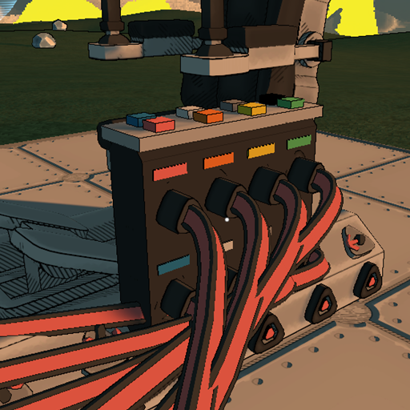
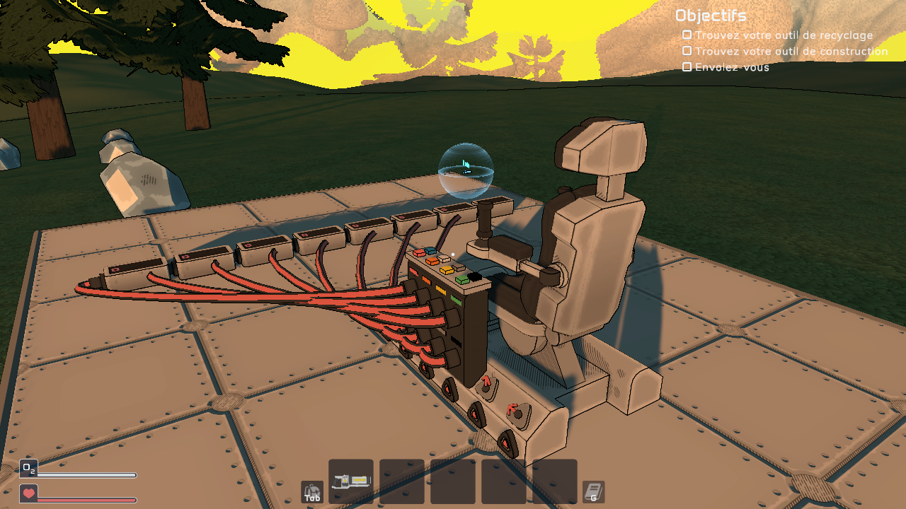
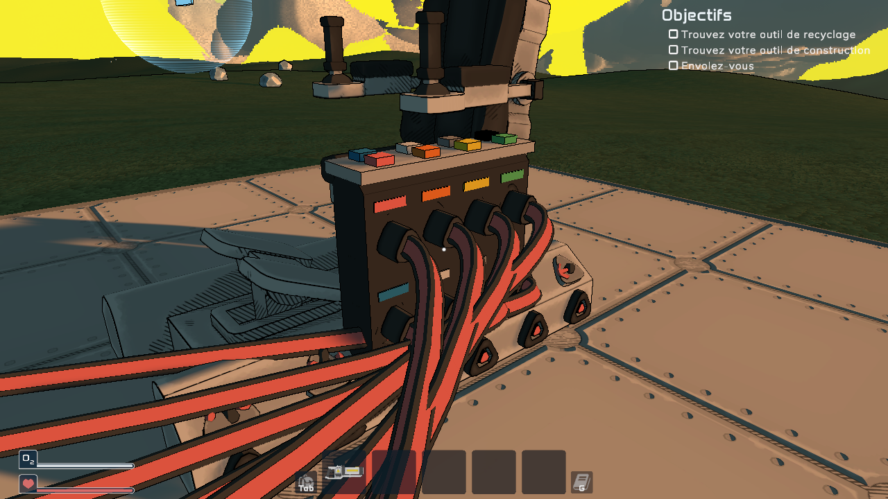
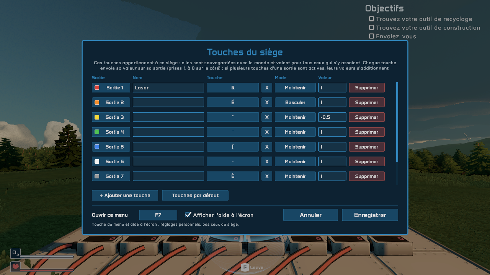
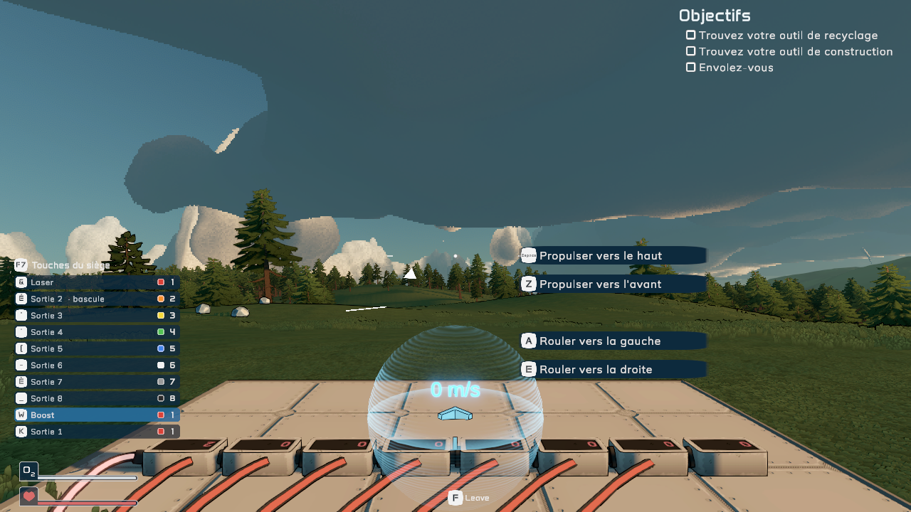

# Command Seat — StellarDrive mod

A MelonLoader mod for **StellarDrive (Demo)**: a pilot seat with **8 extra signal outputs driven by keys you choose**.
Packaged for [Stellar Mod Manager](https://github.com/jollyname/StellarModManager).



## The seat

The **command seat** (*Siège de commande*) is a regular pilot seat — it flies the ship exactly like the game's
advanced pilot seat, with the same six movement outputs on its rail — plus a keypad console on its left side
carrying **8 extra signal outputs** and **its own customisable keys**. It sits right after the advanced pilot
seat in the build menu and is unlocked by the same research (*Powered Ship Controls*).



Outputs are numbered **1 to 8, front to back, top row then bottom row**. Each one has a coloured tag that matches
its key on the keypad and its colour in the settings window:
1 red · 2 orange · 3 yellow · 4 green · 5 blue · 6 white · 7 grey · 8 black.

Wire them with signal cables to anything that takes a signal: lights, doors, thrusters, logic gates, memory
registers, displays, [Arsenal](https://github.com/tidic84/StellarDrive-Arsenal) weapons...



## The seat's keys

The keys **belong to the seat**: they are saved with the world and are the same for whoever sits in it, so each
seat of each ship can have its own controls. Sit in the seat and press **F7** to set them up:



Each key has:

- an **output** (1 to 8) — click to go to the next one, right-click for the previous one;
- a **name**, shown in the on-screen help;
- the **key** itself — click, then press any keyboard key, mouse button or gamepad button. `X` unbinds it. If the
  game's piloting controls already use that key, the window says so (both will happen when you press it);
- a **mode** — *Hold*: on while the key is held; *Toggle*: each press switches it on or off;
- a **value** — what it sends while it is on (default `1`; `-1`, `0.5`, `100`... all work).

*+ Add a key* adds a row (up to 24 keys), *Remove* deletes one, *Default keys* puts back the starting set.
Several keys can drive the **same output**: their values add up. For example `Z` → output 1 = `1` and
`S` → output 1 = `-1` turns output 1 into an axis (−1 / 0 / +1) for a hinge or a thruster.

Changes are applied with *Save* (or Escape) and sent to every player; *Cancel* drops them. Key names follow your
keyboard layout (AZERTY shows `&`, `é`, `"`... for the number row).

While seated, the seat's keys are listed in the bottom-left corner like the game's own control prompts: the key, its
name and the output it drives; a key lights up while it is on.



Good to know:

- A new seat starts with keys `1` to `8` (the number row) on outputs 1 to 8, *Hold*, value `1`.
- Keys do nothing while a menu or the chat is open, so typing doesn't fire outputs.
- When you leave the seat, every output goes back to 0 (toggles included).
- The seat's keys are stored next to the world in `WorldSaves/<world>/keyseat.txt`. Removing the seat forgets them.
- The window key (F7) and showing the on-screen help are your own settings, in `UserData/MelonPreferences.cfg`
  (category `KeySeat`).

## Multiplayer

Every player needs the mod. The host keeps the seats' keys and sends them to whoever joins; the pilot's client
reads the keys and sends the outputs to the host, which feeds them into the game's own signal network — so
cables and logic behave exactly as with native parts. Anyone sitting in a seat can change its keys.

## Compatibility

Works alongside Arsenal: both mods add outputs to advanced pilot seats without stepping on each other (Arsenal's
gunner seat keeps its 3 fire outputs).

A world saved with command seats needs the mod to load them, as with any mod part.

## Building

Needs the .NET SDK (6+), the game, and MelonLoader 0.7.x installed in the game folder (Stellar Mod Manager installs it for you).

```powershell
./build.ps1                                   # default Steam path
./build.ps1 -GamePath "D:\SteamLibrary\steamapps\common\StellarDrive Demo"
```

This produces `dist/StellarDrive-CustomSeat.zip` in the layout Stellar Mod Manager expects:

```
mod.json
Mods/KeySeat.dll
```

`./dev.sh` builds with `DEV`, starts the game on a copy of a test world, spawns a ship with a command seat wired to
8 signal displays, sets the seat's keys, presses keys through the Input System, logs what the displays receive and
saves the world (`src/Dev/DevTest.cs`). `KS_PHASE=2 ./dev.sh` then reopens that world and checks the seat kept its keys.

## Publishing to Stellar Mod Manager

1. Push this folder to a GitHub repo named `StellarDrive-CustomSeat` (branch `main`), keeping `Mods/mod.json` and `Mods/Thumbnail.png`.
2. Create a release tagged `v1.1.0` (must match `version` in `mod.json`) and attach `StellarDrive-CustomSeat.zip` (the asset name must be `<repo>.zip`).
3. Open a PR on [jollyname/StellarModRepository](https://github.com/jollyname/StellarModRepository) adding to `mods.json`:

```json
{ "author": "<your GitHub user>", "repo": "StellarDrive-CustomSeat", "metadata": "Mods" }
```

For a new version: bump `version` in `Mods/mod.json` and in `MelonInfo` (`src/KeySeatMod.cs`), then publish a `v<version>` release with the new zip.
